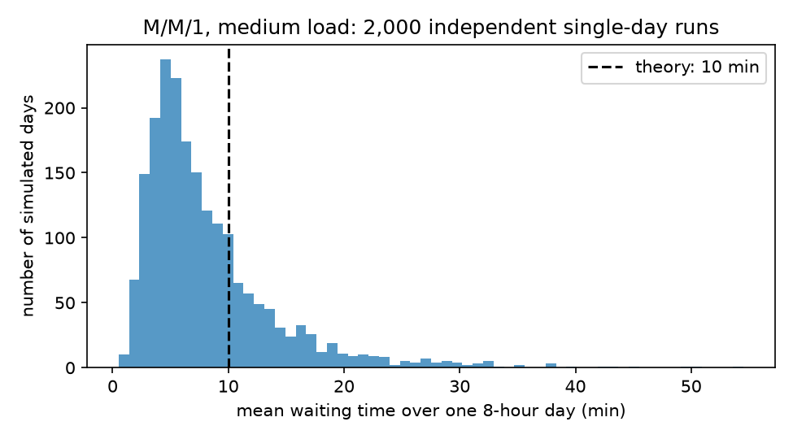
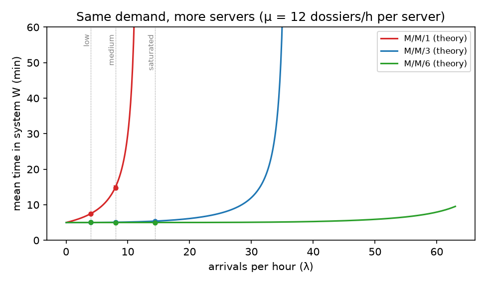
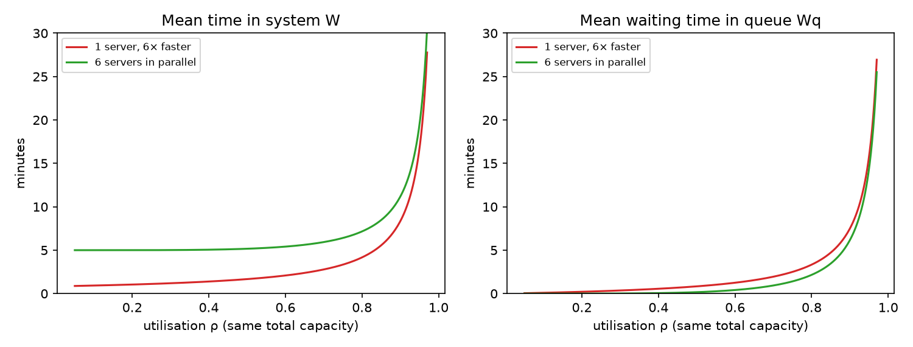
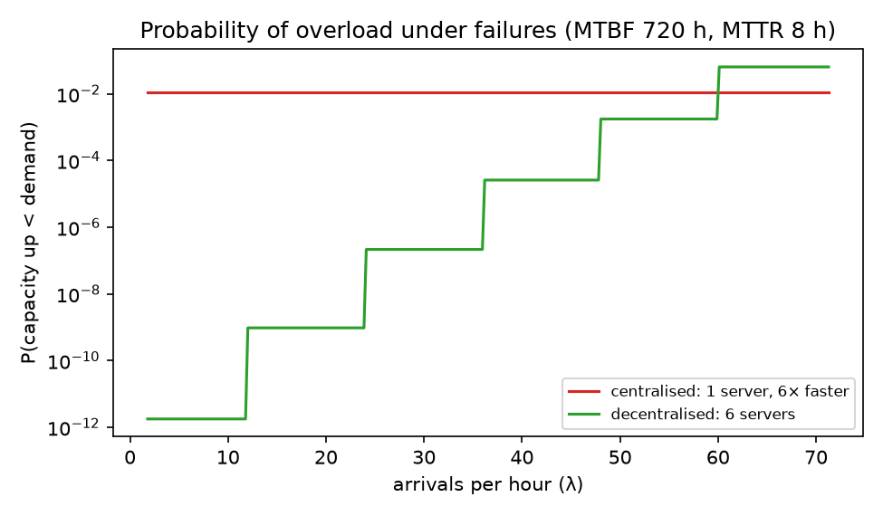
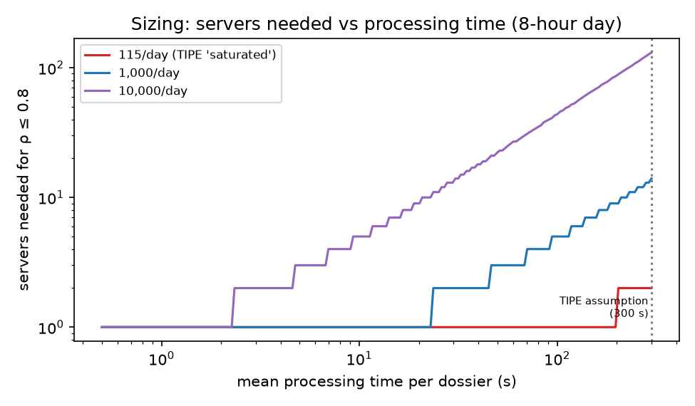
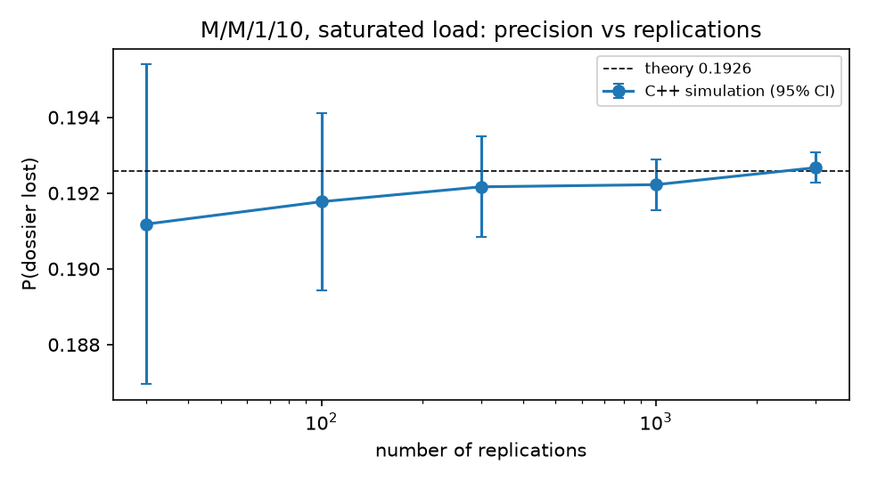

# Queueing models for Tunisie TradeNet: centralised vs decentralised

*TIPE (MP, 2024/2025): "Modélisation et optimisation des systèmes d'échange dans le commerce extérieur tunisien – approche par les files d'attente". Revised and extended in 2026.*

**Python · C++17 · queueing theory · discrete-event simulation · probability · pytest · CMake**

> For a full walkthrough of every module, algorithm, test and result, see [`README_DETAILED.md`](README_DETAILED.md).

Tunisie TradeNet (TTN) is the single electronic platform through which Tunisian customs, banks, ministries, carriers and freight forwarders exchange trade documents. Every message goes through one central system. This project asks: **would a decentralised architecture process dossiers faster and more reliably?**

The system is modelled as a queue:

- **Centralised:** one server, an **M/M/1** queue.
- **Decentralised:** *c* servers in parallel, an **M/M/c** queue.

Each model is studied with closed-form results and with a discrete-event simulator, and the simulator is validated against the theory.

The original TIPE concluded that decentralisation reduces waiting times. The revision shows a more precise answer:

1. **With more servers, delays drop.** But that comes from adding capacity, not from decentralising.
2. **At equal total capacity, one fast central server is actually faster** on average than several slower servers in parallel.
3. **The real benefit of decentralising is resilience.** Total outages practically disappear, provided there is spare capacity.
4. **The original scenarios were not calibrated against real traffic.** The daily volume and the service time per dossier are the key unknowns to measure.

---

## Models

Arrivals are Poisson with rate λ, service times are exponential with rate μ per server, and there are *c* servers. ρ = λ/(cμ) is the utilisation.

| Model | Key results |
|---|---|
| M/M/1 | $W = \dfrac{1}{\mu-\lambda}$, $\quad W_q = \dfrac{\lambda}{\mu(\mu-\lambda)}$, stable if ρ < 1 |
| M/M/c | Erlang C: $P_{wait} = \dfrac{\frac{a^c}{c!}\frac{1}{1-\rho}}{\sum_{k<c}\frac{a^k}{k!} + \frac{a^c}{c!}\frac{1}{1-\rho}}$ with $a=\lambda/\mu$, $\quad W_q = \dfrac{P_{wait}}{c\mu-\lambda}$, $\quad W = W_q + \dfrac1\mu$ |
| M/M/c/K | At most *K* dossiers in the system; birth–death stationary distribution, blocking probability $p_K$, and $W = L/\lambda_{eff}$ (always stable) |

Little's law ($L = \lambda W$) links the averages, and the tests check it.

## Results

Full tables are in [`results/summary.md`](results/summary.md). All numbers below come from `python -m experiments.run_all`.

### 1. The simulator agrees with the theory

| Model | ρ | W theory (s) | W simulated (s, 95% CI) | P(block) theory | P(block) simulated |
|---|---|---|---|---|---|
| M/M/1, medium load | 0.67 | 900 | 896.5 ± 23 | – | – |
| M/M/1/10, saturated load | 1.20 | 2078 | 2097 ± 26 | 0.193 | 0.196 ± 0.005 |
| M/M/3, saturated load | 0.40 | 323.5 | 323.8 ± 1.8 | – | – |
| M/M/6, saturated load | 0.20 | 300.1 | 301.2 ± 1.3 | – | – |

These are 30 independent replications, each covering about 23 days of simulated time, with a warm-up period discarded.

### 2. One simulated day is not enough



At medium load, a day brings only about 64 dossiers. Over 2,000 simulated days, the daily average waiting time ranges from **2.5 to 19.4 min** (5th–95th percentile), around a true mean of 10 min. A single 8-hour run, as in the original TIPE, cannot estimate the mean.

### 3. Same demand, more servers



This reproduces the original TIPE comparison. With 1 server, the saturated scenario (14.4 dossiers/h for a capacity of 12/h) is unstable. With 3 or 6 servers, the mean time is about 5 min. The improvement is real, but it comes from **tripling or multiplying capacity by six**.

### 4. Fair comparison: same total capacity



Compare one server that is 6× faster with 6 servers in parallel. At utilisation 0.8:

- **Waiting time in the queue** is lower with parallel servers: 2.2 min vs 3.3 min.
- **Total time** is higher with parallel servers: 7.2 min vs 4.2 min, because each dossier is processed more slowly.

This is a classical queueing result: decentralising does not reduce delay by itself.

### 5. Resilience under failures



This uses illustrative failure rates: each server fails on average every 720 h and takes 8 h to repair.

| Architecture | Probability of total outage | Expected total-outage hours per year |
|---|---|---|
| Centralised, 1 server | 1.1 × 10⁻² | 96 h |
| Decentralised, 6 servers | 1.8 × 10⁻¹² | ≈ 0 |

This is the real argument for decentralisation. The figure also shows its limit: near full load (above 60 dossiers/h here), losing any one of the 6 servers already causes overload. Decentralisation only helps if there is spare capacity (N+1 redundancy).

### 6. Sizing: how many servers for a given volume?



The original scenarios were not calibrated against measured traffic: the "saturated" one is only 14.4 dossiers per hour (about 115 per day). For hypothetical volumes of 1,000 and 10,000 dossiers per day, keeping ρ ≤ 0.8 at the assumed 300 s per dossier would need 14 and 131 servers; at 1 s per dossier, one server is enough in every case. **The daily volume and the processing time per dossier are the parameters to measure** before drawing conclusions about a real platform.

### 7. C++ simulator

The simulator also exists in C++17 ([`cpp/`](cpp/README.md)), built with CMake and tested against the closed-form results. Python keeps the theory, analysis and plots; C++ does the heavy simulation. Both agree with theory, and the C++ version processes about **20–25× more events per second** (24× on the latest run; the ratio depends on the machine). 3,000 replications of the saturated scenario take about 2 s, which shrinks the confidence interval on the loss probability from ±0.004 to ±0.0004.



Details: [`results/cpp_benchmark.md`](results/cpp_benchmark.md).

## What was corrected from the 2025 version

The original code is kept unchanged in [`original/tipe_2025.py`](original/tipe_2025.py), reconstructed from the slide annex.

| Issue in the 2025 version | Effect | Fix |
|---|---|---|
| Waiting times recorded only for dossiers that queued; dossiers served immediately (wait 0) were skipped | Waiting-time histogram and mean biased upwards (e.g. in one simulated medium-load day, 61 arrivals but only 34 waits recorded) | Every served dossier is recorded |
| Queue length averaged per *event* | Events are not equally spaced in time, so averages and plots were distorted | Time-weighted averages |
| Simulation used a capacity limit (K = 10) but the formulas assumed an infinite queue | Saturated case: theory says "infinite", simulation silently drops 19% of dossiers | M/M/c/K formulas added; lost dossiers reported |
| A single 8-hour run per scenario (about 30–115 dossiers) | Results are mostly noise | 30 replications, warm-up, 95% confidence intervals |
| W(ρ) and L(ρ) for M/M/1, M/M/3 and M/M/6 compared at equal ρ | At equal ρ, M/M/6 handles 6× more traffic, so the curves don't compare the same situation | Comparisons at equal demand and at equal total capacity |
| Conclusion "decentralised is faster" | True only when capacity is added | Equal-capacity comparison plus resilience analysis |
| Scenarios not linked to measured traffic | Conclusions depend on volumes that were never checked | Sizing section: servers needed as a function of volume and processing time |

## Run it

```bash
python -m venv .venv
.venv\Scripts\activate            # Windows  (macOS/Linux: source .venv/bin/activate)
pip install -r requirements.txt
pytest -q                          # 13 tests (the C++ one is skipped until it is built)
python -m experiments.run_all      # all figures and tables, about 5 s

# C++ simulator (needs CMake and a C++17 compiler, see cpp/README.md)
cmake -S cpp -B cpp/build
cmake --build cpp/build --config Release
ctest --test-dir cpp/build -C Release
python -m experiments.cpp_benchmark
```

**In VS Code:** open the folder, select the `.venv` interpreter, and use the Run and Debug panel. For the C++ part, the CMake Tools extension configures and builds `cpp/`. There are ready-made configurations for "Run all experiments", "Run original TIPE code (2025)" and "Debug tests". The Testing panel also picks up the tests automatically.

## Project structure

```
queueing/
├── theory.py         # M/M/1, M/M/c (Erlang C), M/M/c/K closed forms
├── simulation.py     # discrete-event simulator, replications, confidence intervals
├── reliability.py    # availability, outage and overload probabilities
└── cpp_bridge.py     # runs the C++ simulator and reads its output
cpp/                    # C++17 simulator, CMake build, tests
experiments/run_all.py  # experiments 1–6
experiments/cpp_benchmark.py  # C++ vs Python: validation, speed, replications
tests/                  # theory checks, simulation vs theory, blocking, reliability
original/tipe_2025.py   # original TIPE code, unchanged
results/                # generated figures and tables
docs/                   # original slides and MCOT (local only, ignored by git)
```

## Limits

- Exponential service times are an assumption; real processing times may be closer to deterministic (M/D/c) or general (M/G/c).
- Failure rates in section 5 are illustrative, not TTN measurements.
- Arrival rates vary over the day and week; a non-homogeneous Poisson process would be more realistic.
