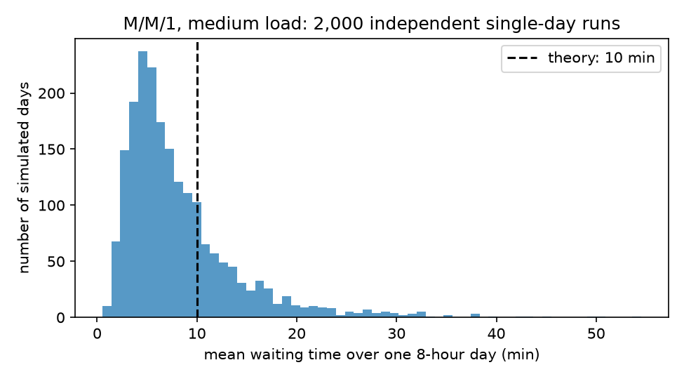
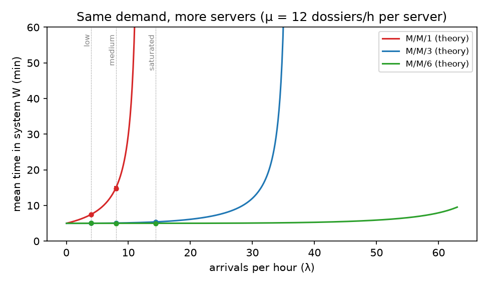
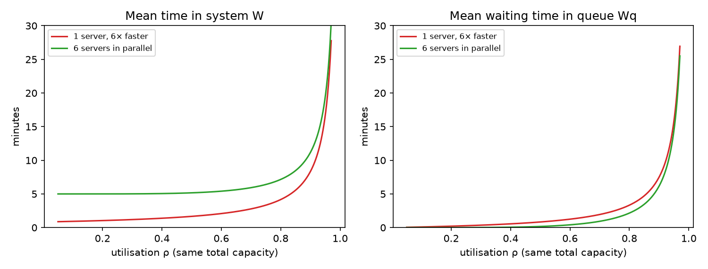
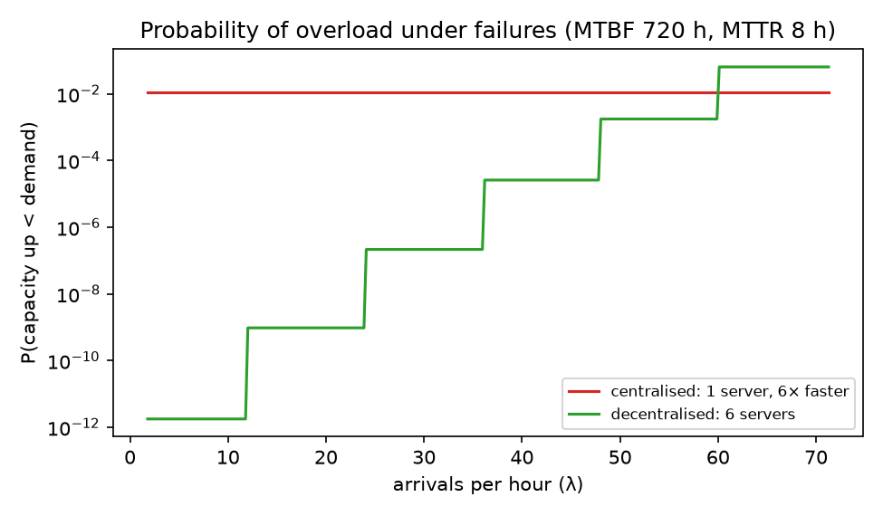
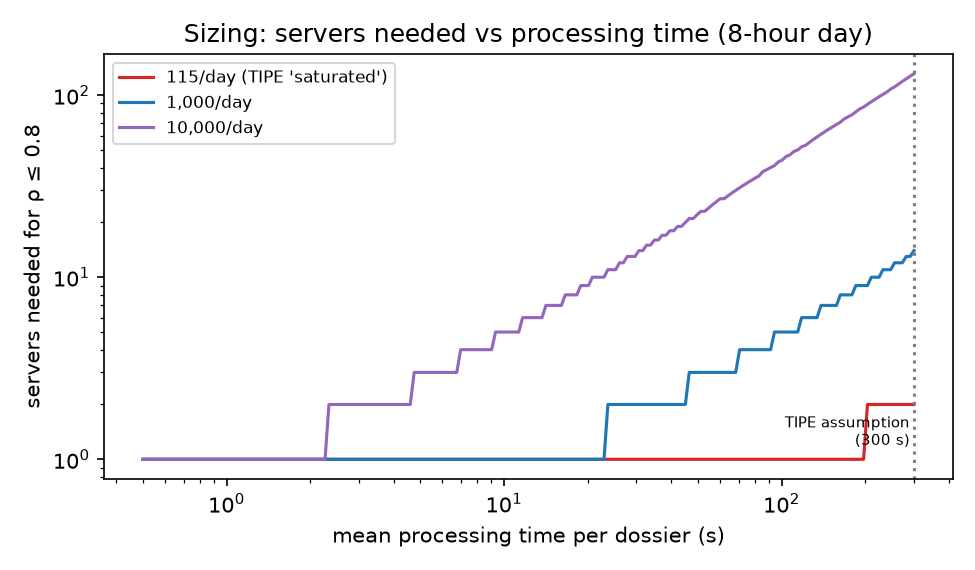
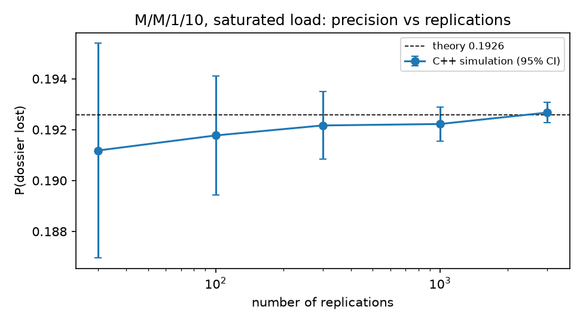

# Detailed walkthrough: what the code does, and what it found

This is the long version of [`README.md`](README.md). It covers the question, the models, every module and its algorithm, the tests, each experiment (with exact parameters), the results, and what was wrong in the 2025 code.

All numbers here come from running the code on 2026-10-25 (`pytest`, `ctest`, `python -m experiments.run_all`, `python -m experiments.cpp_benchmark`). The generated tables are in [`results/summary.md`](results/summary.md) and [`results/cpp_benchmark.md`](results/cpp_benchmark.md).

---

## Contents

1. [The question](#1-the-question)
2. [The model and its assumptions](#2-the-model-and-its-assumptions)
3. [Units and parameters used everywhere](#3-units-and-parameters-used-everywhere)
4. [`queueing/theory.py`: closed-form results](#4-queueingtheorypy-closed-form-results)
5. [`queueing/simulation.py`: the discrete-event simulator](#5-queueingsimulationpy-the-discrete-event-simulator)
6. [`queueing/reliability.py`: failures and resilience](#6-queueingreliabilitypy-failures-and-resilience)
7. [The C++ simulator and `queueing/cpp_bridge.py`](#7-the-c-simulator-and-queueingcpp_bridgepy)
8. [Tests](#8-tests)
9. [Experiments and results](#9-experiments-and-results)
10. [The original 2025 code and what was wrong with it](#10-the-original-2025-code-and-what-was-wrong-with-it)
11. [Conclusions](#11-conclusions)
12. [Limits and next steps](#12-limits-and-next-steps)
13. [Reproducing everything](#13-reproducing-everything)

---

## 1. The question

Tunisie TradeNet (TTN) is the single electronic platform through which customs, banks, ministries, carriers and freight forwarders exchange trade documents ("dossiers"). Every message goes through one central system.

**Would a decentralised architecture, with several processing nodes in parallel, process dossiers faster and more reliably than the current centralised one?**

We answer it with queueing theory. A dossier is a *customer*, a processing node is a *server*, and the time a dossier spends in TTN is the *time in system*.

## 2. The model and its assumptions

We use Kendall notation **A/S/c/K**:

| Symbol | Meaning | Our choice |
|---|---|---|
| A | arrival process | **M**: Poisson arrivals, rate λ (exponential inter-arrival times) |
| S | service time distribution | **M**: exponential, rate μ per server (mean 1/μ) |
| c | number of servers | 1 (centralised) or 3, 6 (decentralised) |
| K | maximum number of dossiers in the system (in service + waiting) | ∞ by default; K = 10 to reproduce the 2025 simulation |

The queue discipline is FIFO (first come, first served), and any free server takes the next dossier.

Derived quantities:

- **Offered load** a = λ/μ: the average number of servers that would be busy if capacity were unlimited.
- **Utilisation** ρ = λ/(cμ): the fraction of time each server is busy. For K = ∞ the queue is **stable only if ρ < 1**. Otherwise it grows without bound.

Output metrics, all in steady state:

| Metric | Meaning |
|---|---|
| W | mean time in system (waiting + service) |
| W_q | mean waiting time in the queue, before service starts |
| L | time-average number of dossiers in the system |
| L_q | time-average number of dossiers waiting |
| P_wait | probability that an arriving dossier has to wait |
| p_block | for finite K: probability that an arrival is rejected because the system is full |

**Little's law** links them: L = λ_eff · W and L_q = λ_eff · W_q, where λ_eff = λ(1 − p_block) is the rate of dossiers actually admitted. The code checks this law both in theory and in simulation.

## 3. Units and parameters used everywhere

Time is in **seconds** in the code. Results are shown in minutes or hours where that reads better.

| Parameter | Value | Where it comes from |
|---|---|---|
| μ | 1/300 s⁻¹, i.e. 5 min per dossier (12 dossiers/h per server) | 2025 TIPE assumption |
| Day length | 8 h = 28,800 s | 2025 TIPE assumption |
| λ, "low" | 1/900 s⁻¹ = 4 dossiers/h | 2025 TIPE scenario |
| λ, "medium" | 1/450 s⁻¹ = 8 dossiers/h | 2025 TIPE scenario |
| λ, "saturated" | 1/250 s⁻¹ = 14.4 dossiers/h | 2025 TIPE scenario |
| K | 10 | capacity limit used in the 2025 simulator |
| Replications | 30 | new in 2026 |
| Horizon per replication | 2×10⁶ s ≈ 23 days | new in 2026 |
| Warm-up discarded | 5×10⁴ s ≈ 14 h | new in 2026 |

Note that "saturated" with one server means ρ = 14.4/12 = **1.2 > 1**, so an M/M/1 queue with these numbers is unstable.

## 4. `queueing/theory.py`: closed-form results

Every function returns a dict with `rho, L, Lq, W, Wq` (plus `p_wait` or `p_block`, `lam_eff`, `p` where relevant).

### 4.1 `erlang_c(c, a)`: probability of waiting in M/M/c

$$P_{wait} = C(c,a) = \frac{\dfrac{a^c}{c!}\dfrac{1}{1-\rho}}{\displaystyle\sum_{k=0}^{c-1}\frac{a^k}{k!} + \frac{a^c}{c!}\frac{1}{1-\rho}}$$

**Implementation detail:** the terms aᵏ/k! are built iteratively (`term *= a / k`) instead of calling `a**k / math.factorial(k)`. This avoids huge intermediate numbers when c is large: the sizing section needs c up to about 131. If ρ ≥ 1 it returns 1, since every arrival eventually waits.

### 4.2 `mmc(lam, mu, c)` and `mm1(lam, mu)`

$$W_q = \frac{C(c,a)}{c\mu - \lambda}, \qquad W = W_q + \frac1\mu, \qquad L = \lambda W, \qquad L_q = \lambda W_q$$

If ρ ≥ 1 it returns infinity for every metric. `mm1` is just `mmc` with c = 1, and the test suite checks that this matches the textbook formulas W = 1/(μ − λ) and W_q = λ/(μ(μ − λ)).

### 4.3 `mmck(lam, mu, c, K)`: finite capacity

M/M/c/K is a birth–death chain on states n = 0…K, with birth rate λ and death rate min(n, c)·μ. The stationary distribution satisfies

$$p_n = p_{n-1}\cdot\frac{a}{\min(n,c)}, \qquad \sum_{n=0}^{K} p_n = 1$$

The code builds the unnormalised pₙ with that recurrence, normalises, and computes:

- L = Σ n·pₙ and L_q = Σ (n − c)·pₙ over n > c
- p_block = p_K (by PASTA, Poisson arrivals see the time-average state, so an arrival is blocked with probability p_K)
- λ_eff = λ(1 − p_K), W = L/λ_eff, W_q = L_q/λ_eff

This model is **always stable**, whatever ρ, because excess arrivals are dropped. It raises `ValueError` if K < c.

### 4.4 `servers_needed(lam, mu, max_rho=0.8)`

The smallest c such that λ/(cμ) ≤ max_rho, i.e. ⌈λ/(μ · max_rho)⌉. It is used in the sizing experiment. 0.8 is a common engineering target that keeps queues short and leaves headroom.

### 4.5 Theory values for the 2025 scenarios

From `mmc` with μ = 1/300 s⁻¹:

| λ (per h) | c | ρ | W (s) | W_q (s) | L | P_wait |
|---|---|---|---|---|---|---|
| 4.0 | 1 | 0.33 | 450 | 150 | 0.50 | 0.333 |
| 8.0 | 1 | 0.67 | 900 | 600 | 2.00 | 0.667 |
| 14.4 | 1 | 1.20 | ∞ | ∞ | ∞ | 1 |
| 4.0 | 3 | 0.11 | 300.6 | 0.56 | 0.33 | 0.005 |
| 8.0 | 3 | 0.22 | 304.2 | 4.18 | 0.68 | 0.033 |
| 14.4 | 3 | 0.40 | 323.5 | 23.5 | 1.29 | 0.141 |
| 4.0 | 6 | 0.06 | 300.0 | ≈0 | 0.33 | 1.4×10⁻⁶ |
| 8.0 | 6 | 0.11 | 300.0 | 0.004 | 0.67 | 7.0×10⁻⁵ |
| 14.4 | 6 | 0.20 | 300.1 | 0.098 | 1.20 | 0.0016 |

With 3 or 6 servers, W is almost exactly 1/μ = 300 s: dossiers almost never wait, so the time in system is just the service time.

M/M/1/10 in the saturated case (ρ = 1.2): L = 6.71, p_block = **0.1926** (19% of dossiers lost), λ_eff = 11.6 per hour, W = 2078 s ≈ 35 min.

## 5. `queueing/simulation.py`: the discrete-event simulator

### 5.1 What `simulate(lam, mu, c, K, horizon, warmup, seed, keep_trace)` does

It is a **next-event simulation**: time jumps from one event to the next, and nothing happens in between. Its state is:

| Variable | Data structure | Meaning |
|---|---|---|
| `queue` | `deque` of arrival times | dossiers waiting, in FIFO order |
| `busy` | min-heap of `(departure_time, arrival_time)` | one entry per busy server. The top is the next departure |
| `next_arr` | float | time of the next arrival |
| `area_n`, `area_q` | floats | running integrals ∫N(t)dt and ∫N_q(t)dt |

Each loop iteration does the following:

1. **Next event:** `t_next = min(next_arr, busy[0][0])`, capped at `horizon`.
2. **Integrate the state** over [t, t_next]: add `(len(queue)+len(busy)) * dt` to `area_n` and `len(queue) * dt` to `area_q`, counting only the part after `warmup`. This yields **time-weighted** averages L = area_n / (horizon − warmup).
3. **Arrival:**
   - if K is set and the system already holds K dossiers, count it as **blocked**;
   - else if a server is free, start service right away (push its departure time on the heap) and **record a wait of 0**;
   - else append it to the queue.

   Then draw the next arrival time, t + Exp(λ).
4. **Departure:** pop the heap and record the sojourn time t − arrival. If the queue is non-empty, the server takes the head of the queue: record its wait, t − arrival, and push its departure.

Only dossiers that **arrive after the warm-up** are counted in `waits`, `sojourns`, `arrivals` and `blocked`. This removes the start-up bias of beginning with an empty system.

It returns a `SimResult` with `Wq, W, L, Lq, p_block, served`, the array of all waits, and optionally a trace of the queue length over time, for plots.

**Why a heap?** With c servers, finding the next departure is O(log c) instead of scanning a list (which is what the 2025 code did with `prochains_departs.index(...)`). The heap also stores each customer's arrival time, which makes the sojourn-time measurement exact.

### 5.2 `replicate(n_reps, **kwargs)`: independent replications

It runs `simulate` n_reps times with seeds `seed, seed+1, …` and, for each metric, returns `(mean, half-width of a 95% confidence interval)`:

$$\bar x \pm t_{0.975,\,n-1}\cdot\frac{s}{\sqrt n}$$

where s is the sample standard deviation across replications and t is the Student quantile (from SciPy, or 1.96 as a fallback). Each replication's mean is one observation, which sidesteps the strong autocorrelation between consecutive dossiers inside a single run.

## 6. `queueing/reliability.py`: failures and resilience

Each server alternates between *up* and *down*. Mean time between failures is MTBF and mean time to repair is MTTR, and servers fail independently.

- `availability(mtbf, mttr)` returns A = MTBF / (MTBF + MTTR), the long-run fraction of time one server is up.
- `up_distribution(c, A)` gives the number of servers up, which is **Binomial(c, A)**: P(k up) = C(c,k)·Aᵏ(1−A)^(c−k).
- `outage_probability(c, A)` returns (1 − A)^c, the probability that **all** servers are down at once.
- `overload_probability(lam, mu, c, A)` returns Σ P(k up) over every k with k·μ ≤ λ, the probability that the servers currently up **cannot keep up** with demand.

**Quasi-static approximation:** failures happen over hundreds of hours, while dossiers arrive every few minutes. So while k servers are up, the system behaves like an M/M/k queue in steady state, and "overloaded" means that M/M/k is unstable.

## 7. The C++ simulator and `queueing/cpp_bridge.py`

### 7.1 Why C++

Python processes about 0.9 million events per second. Tight confidence intervals, for example on a 19% loss probability, need thousands of replications. The C++17 version does the heavy simulation, and Python keeps the theory, the analysis and the plots.

### 7.2 Files

| File | Content |
|---|---|
| `cpp/include/mmck.hpp` | `Params` (λ, μ, c, K = −1 for unlimited, horizon, warmup), `Result` (Wq, W, L, Lq, p_block, served, events), `simulate()` |
| `cpp/src/mmck.cpp` | Same algorithm as the Python version: `std::priority_queue` min-heap of busy servers, `std::deque` FIFO queue, time-weighted areas, warm-up handling, zero waits recorded. Uses the `std::mt19937_64` RNG and `std::exponential_distribution`. Stores sums and counts instead of whole arrays, so memory use stays constant |
| `cpp/src/main.cpp` | Command-line tool `mmck_sim --lam … --mu … --c … --K … --horizon … --warmup … --reps … --seed …`. It validates the inputs and prints one CSV row per replication: `rep,Wq,W,L,Lq,p_block,served,events,seconds` |
| `cpp/tests/test_mmck.cpp` | Self-contained test with its own Erlang C and M/M/c/K formulas (see §8.2) |
| `cpp/CMakeLists.txt` | C++17, Release by default, warnings on (`-Wall -Wextra -Wpedantic` or `/W4`). Builds the `mmck` library, `mmck_sim` and `test_mmck`, and registers the test with CTest |

### 7.3 Python bridge

`find_binary()` looks for `mmck_sim(.exe)` in `cpp/build/`, `cpp/build/Release/` and `cpp/build/Debug/`. `run_cpp(...)` calls it with `subprocess.run` and parses the CSV into a list of dicts. `summarise(rows, metric)` computes the mean and the 95% CI half-width, exactly like `replicate`.

## 8. Tests

### 8.1 Python, `tests/test_queueing.py`: 13 tests, all passing

| Test | What it checks |
|---|---|
| `test_erlang_c_known_value` | C(2, 1) = 1/3, the textbook value |
| `test_mmc_with_one_server_is_mm1_formula` | `mm1` gives W = 1/(μ−λ) and W_q = λ/(μ(μ−λ)) |
| `test_littles_law_in_theory` | L = λW for c = 1, 3, 6 whenever the queue is stable |
| `test_unstable_queue_is_infinite` | ρ = 1.2 gives W = ∞ |
| `test_finite_capacity_converges_to_infinite_model` | M/M/3/200 matches M/M/3 to a relative error of 10⁻⁹ |
| `test_simulation_matches_theory[1]`, `[3]` | 10 replications of M/M/1 (ρ = 0.67) and M/M/3 (ρ = 0.83): simulated W, W_q and L lie within max(3 CI half-widths, 5%) of theory |
| `test_simulated_blocking_matches_theory` | M/M/1/10 at ρ = 1.2: simulated p_block lies within max(3 CI half-widths, 0.01) of 0.1926 |
| `test_zero_waits_are_recorded` | With 6 servers at low load, more than 90% of recorded waits are exactly 0. This guards against the 2025 bug |
| `test_reliability` | outage = 1 − A for 1 server and (1 − A)⁶ for 6. With λ = 0, overload means all servers down |
| `test_servers_needed` | the saturated scenario needs 2 servers for ρ ≤ 0.8 |
| `test_run_all_writes_utf8_summary` | runs `python -m experiments.run_all` as a subprocess with UTF-8 mode off and stdout piped (where Windows falls back to cp1252, which lacks λ and ρ), and checks that it exits cleanly and that `results/summary.md` is non-empty and contains λ |
| `test_cpp_simulator_matches_theory` | runs the C++ binary: M/M/3 W and M/M/1/10 p_block against theory. It is skipped if the binary is not built |

### 8.2 C++, `ctest`: passing

`test_mmck` prints one PASS/FAIL line per check:

- M/M/1 medium load, W, 20 replications, tolerance 3%
- M/M/3 saturated load, W, tolerance 1%
- M/M/1/10 saturated load, p_block, tolerance 5%
- Little's law L = λW within one long run (M/M/3, ρ = 0.83, horizon 10⁷ s), tolerance 2%

## 9. Experiments and results

`python -m experiments.run_all` runs experiments 1–6 in about 7 s and writes the figures and `results/summary.md`. `python -m experiments.cpp_benchmark` runs experiment 7 and writes `results/cpp_benchmark.md` and `cpp_replications.png`.

### 9.1 Experiment 1: the simulator agrees with the theory

**Method:** 4 configurations × 30 replications × 2×10⁶ s, warm-up 5×10⁴ s, seeds starting at 100. Theory comes from `mmc` or `mmck`. The results are also saved as `results/validation.csv`.

| Model | ρ | W theory (s) | W simulated (s) | W_q theory (s) | W_q simulated (s) | p_block theory | p_block simulated |
|---|---|---|---|---|---|---|---|
| M/M/1, medium | 0.67 | 900 | 896.5 ± 23 | 600 | 596.1 ± 22 | 0 | 0 |
| M/M/1/10, saturated | 1.20 | 2078 | 2097 ± 26 | 1778 | 1796 ± 24 | 0.1926 | 0.1963 ± 0.0046 |
| M/M/3, saturated | 0.40 | 323.5 | 323.8 ± 1.8 | 23.53 | 23.20 ± 0.78 | 0 | 0 |
| M/M/6, saturated | 0.20 | 300.1 | 301.2 ± 1.3 | 0.098 | 0.081 ± 0.027 | 0 | 0 |

**Reading:** every theoretical value lies inside, or within about one half-width of, the simulated 95% CI. The simulator is correct, so it can be trusted in cases where no formula exists.

### 9.2 Experiment 2: one simulated day is not enough

**Method:** M/M/1 at medium load (ρ = 0.67), **2,000 independent 8-hour runs** (seeds 0–1999), the mean W_q of each day recorded and histogrammed.



**Result:** a day contains only about 64 dossiers. The daily mean waiting time ranges from **2.5 to 19.4 min** (5th–95th percentile) around the true value of **10.0 min**. A single 8-hour run, which is what the 2025 TIPE did, can land anywhere in that range. Consecutive waits are strongly correlated, so 64 dossiers carry much less information than 64 independent samples would.

### 9.3 Experiment 3: same demand, more servers (the 2025 comparison)

**Method:** theoretical W for M/M/1, M/M/3 and M/M/6 over λ ∈ (0, 63) dossiers/h, plus simulated points (10 replications, with CI bars) at the three scenarios.



| Scenario | λ (per h) | W, M/M/1 (min) | W, M/M/3 (min) | W, M/M/6 (min) |
|---|---|---|---|---|
| low | 4.0 | 7.5 | 5.0 | 5.0 |
| medium | 8.0 | 15.0 | 5.1 | 5.0 |
| saturated | 14.4 | unstable | 5.4 | 5.0 |

**Reading:** more servers clearly help. But each added server is a full extra 12 dossiers/h of capacity, so M/M/3 has 3× the capacity of M/M/1. This comparison measures the effect of **adding capacity**, not of decentralising.

### 9.4 Experiment 4: fair comparison at equal total capacity

**Method:** compare **one server of rate 6μ** (centralised, 6× faster) with **6 servers of rate μ** (decentralised), both with total capacity 6μ = 72 dossiers/h, for ρ from 0.05 to 0.97.



At ρ = 0.8:

| | W_q (min) | W (min) |
|---|---|---|
| Centralised, 1 fast server | 3.3 | **4.2** |
| Decentralised, 6 servers | **2.2** | 7.2 |

**Why:** with parallel servers, a dossier is less likely to wait (the queue is shared by 6 servers), but once served it takes 1/μ = 5 min instead of 1/(6μ) = 50 s. The service-time penalty outweighs the queueing gain at every load. This is a classical result: **for the same total capacity, pooling into one fast server minimises the mean time in system.** Decentralising does not reduce delay by itself.

### 9.5 Experiment 5: resilience under failures

**Method:** illustrative values MTBF = 720 h (one failure a month) and MTTR = 8 h, so A = 0.98901. We compare 1 server of rate 6μ with 6 servers of rate μ (the same capacity as in §9.4), using `outage_probability` and `overload_probability` over λ.



| Architecture | P(total outage) | Expected total-outage hours per year |
|---|---|---|
| Centralised (1 server) | 1.10×10⁻² | **96.3 h** |
| Decentralised (6 servers) | 1.76×10⁻¹² | 1.5×10⁻⁸ h (never, in practice) |

**Reading:**

- **This is the real advantage of decentralising.** With 6 nodes, a single failure only removes 1/6 of the capacity, and a total outage needs 6 simultaneous failures.
- **The limit:** the overload curve for 6 servers jumps once λ > 5μ = 60 dossiers/h. From there, losing *any one* of the 6 servers leaves too little capacity. P(at least one of 6 down) ≈ 6 × 1.1% ≈ 6.4%, which is *worse* than the centralised 1.1%. Decentralisation only pays off with **spare capacity** (N+1 redundancy).

### 9.6 Experiment 6: sizing, servers needed for a given volume

**Method:** three *hypothetical* daily volumes over an 8-hour day: the 2025 "saturated" scenario (14.4/h, about 115 per day), 1,000 per day and 10,000 per day. For each, we plot `servers_needed(λ, 1/s, 0.8)` for service times s from 0.5 to 300 s. These volumes are illustrations, not measurements.



| Daily volume | λ (per h) | Servers at 300 s | Servers at 30 s | Servers at 1 s |
|---|---|---|---|---|
| 115 (TIPE "saturated") | 14.4 | 2 | 1 | 1 |
| 1,000 | 125 | 14 | 2 | 1 |
| 10,000 | 1,250 | 131 | 14 | 1 |

**Reading:** the number of servers scales with the offered load a = λ/μ, i.e. volume × processing time. Over the plausible range of processing times, the answer moves from one server to more than a hundred. The 2025 scenarios were never checked against measured traffic, so **the daily volume and the processing time per dossier are the next things to measure** before drawing any conclusion about a real platform.

### 9.7 Experiment 7: C++ vs Python

**Validation:** the same 4 configurations as §9.1, 30 replications each, both languages.

| Model | W theory (s) | W Python (s) | W C++ (s) | p_block theory | p_block C++ |
|---|---|---|---|---|---|
| M/M/1, medium | 900.0 | 896.5 ± 23.1 | 894.2 ± 19.5 | 0 | 0 |
| M/M/1/10, saturated | 2077.8 | 2096.9 ± 26.0 | 2068.5 ± 26.2 | 0.1926 | 0.1897 ± 0.0049 |
| M/M/3, saturated | 323.5 | 323.8 ± 1.8 | 324.9 ± 1.8 | 0 | 0 |
| M/M/6, saturated | 300.1 | 301.2 ± 1.3 | 300.6 ± 1.3 | 0 | 0 |

The two simulators use different RNGs (Python's Mersenne Twister vs `mt19937_64`), so individual numbers differ, but both agree with the theory.

**Speed** (M/M/3 at ρ = 0.83, λ = 2.5, μ = 1, same machine):

| Simulator | Events | Time (s) | Events/s |
|---|---|---|---|
| Python | ≈ 1.0 M | 1.11 | ≈ 0.9 M |
| C++ (Release, MinGW g++) | ≈ 10.0 M | 0.47 | ≈ 21 M |

That is about **24× faster** on this machine. Earlier runs measured 18–25×; the ratio depends on the machine and its load. The Python event count is approximated as 2 × served, while C++ counts events exactly.

**What the speed buys:** 3,000 replications of M/M/1/10 saturated (about 43 M events) take **1.8 s** in C++ against an estimated 48 s in Python. The 95% CI on the loss probability shrinks from **±0.0042 with 30 runs to ±0.0004 with 3,000 runs**, around the theoretical 0.1926. A 10× narrower CI needs 100× more runs (1/√n).



## 10. The original 2025 code and what was wrong with it

[`original/tipe_2025.py`](original/tipe_2025.py) is kept unchanged, reconstructed from the slide annex. It still runs. It contains `simuler_mm1`, `simuler_mmc`, `metriques_mm1` and `metriques_mmc`, and it plots W(ρ) for M/M/1, M/M/3 and M/M/6.

| # | Problem in the 2025 code | Where | Consequence | How the new code fixes it |
|---|---|---|---|---|
| 1 | `temps_attente` only gets a value when a dossier leaves the queue. Dossiers served immediately (wait 0) are never recorded | departure branch of `simuler_mm1` and `simuler_mmc` | mean wait and histogram biased upwards (e.g. 61 arrivals in a day but only 34 waits recorded) | a wait of 0 is recorded on arrival when a server is free, and a test enforces it |
| 2 | `longueurs_file.append(...)` once per **event** | top of both loops | events are not equally spaced, so the average queue length is not the time-average L_q | time-weighted integration of N(t) and N_q(t) |
| 3 | The simulation uses `capacite_max = 10`, but the formulas assume K = ∞ | `simuler_*` vs `metriques_*` | saturated case: theory says "infinite queue", while the simulation silently drops about 19% of dossiers (`perdus` is computed but never returned) | `mmck` formulas, with `p_block` returned and compared |
| 4 | One 8-hour run per scenario, `random.seed(42)` | `__main__` | 30–115 dossiers per run, so the results are mostly noise (§9.2) | 30 replications × 23 days, warm-up, 95% CI |
| 5 | Curves for M/M/1, M/M/3 and M/M/6 plotted at **equal ρ** | `taux_occupation` loop | at equal ρ, M/M/6 carries 6× more traffic, so the curves do not compare the same situation | comparisons at equal demand (§9.3) and equal total capacity (§9.4) |
| 6 | Conclusion: "decentralised is faster" | slides | only true when capacity is added | equal-capacity analysis and resilience analysis |
| 7 | Scenarios not linked to measured traffic | parameters | conclusions rest on volumes that were never checked | sizing study over volume and processing time (§9.6) |

The closed-form `metriques_mmc` was actually correct: it uses L_q = P_q·ρ/(1 − ρ), which is the standard Erlang C result. It computes factorials directly, though, which overflows for large c.

## 11. Conclusions

1. **The simulator is validated.** Python and C++ both match the M/M/1, M/M/c and M/M/c/K formulas within their confidence intervals.
2. **More servers means shorter delays**, but that is the effect of more capacity, not of decentralisation.
3. **At equal total capacity, one fast central server gives the shortest mean time in system** (4.2 vs 7.2 min at ρ = 0.8).
4. **Decentralisation's real benefit is resilience.** Total outages drop from about 96 h/year to practically zero, provided there is spare capacity. Near full load, it becomes *more* fragile.
5. **The 2025 scenarios were not calibrated against real traffic.** The daily volume and the per-dossier processing time are the key unknowns to measure.

## 12. Limits and next steps

- **Exponential service** is an assumption. Real processing may be close to deterministic (M/D/c) or general (M/G/c, Pollaczek–Khinchine).
- **Failure rates** in §9.5 are illustrative, not measured.
- **Arrivals vary** over the day and week. A non-homogeneous Poisson process generated by thinning (Lewis–Shedler) is the natural extension. [`cpp/README.md`](cpp/README.md) describes how to add it to `mmck.cpp`.
- **Real data** is not part of this repository. Measured volumes and processing times would replace the hypothetical values in §9.6.
- Minor simulator details: dossiers still in the system at the horizon are not counted in W (negligible over 23 days), and Python returns `nan` for W_q when no wait was recorded while C++ returns 0.

## 13. Reproducing everything

```bash
python -m venv .venv
.venv\Scripts\activate                     # Windows (macOS/Linux: source .venv/bin/activate)
pip install -r requirements.txt

pytest -q                                  # 13 passed

cmake -S cpp -B cpp/build
cmake --build cpp/build --config Release
ctest --test-dir cpp/build -C Release --output-on-failure   # 1/1 passed

python -m experiments.run_all              # experiments 1–6, ~7 s
python -m experiments.cpp_benchmark        # experiment 7, ~10 s
python original/tipe_2025.py               # the original 2025 code
```

Outputs:

| File | Produced by |
|---|---|
| `results/summary.md`, `results/validation.csv` | `run_all` |
| `results/single_day_noise.png`, `same_demand.png`, `equal_capacity.png`, `resilience.png`, `sizing.png` | `run_all` |
| `results/cpp_benchmark.md`, `results/cpp_replications.png` | `cpp_benchmark` |

Random seeds are fixed, so the Python results are identical from run to run. Only the timing figures in experiment 7 change between runs and machines.
